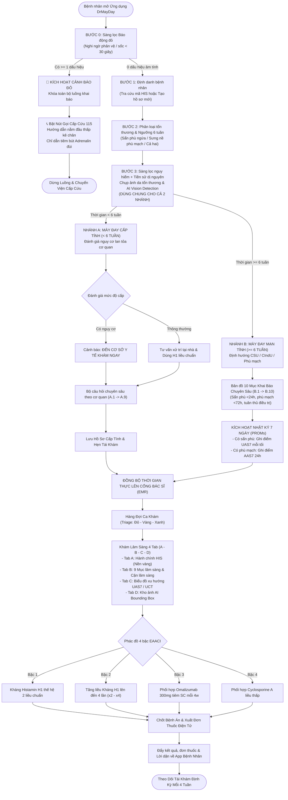
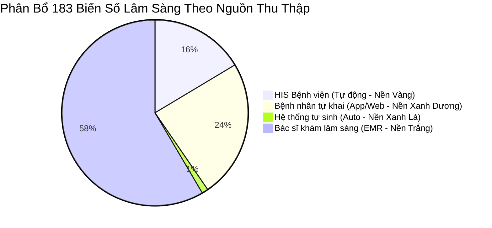

# BỘ Y TẾ — BỆNH VIỆN DA LIỄU TRUNG ƯƠNG
## ĐỀ TÀI NGHIÊN CỨU KHOA HỌC CẤP BỘ
# TÀI LIỆU ĐẶC TẢ NGHIỆP VỤ HỆ THỐNG (BUSINESS SPECIFICATION DOCUMENT)
### HỆ THỐNG TRÍ TUỆ NHÂN TẠO HỖ TRỢ CHẨN ĐOÁN VÀ QUẢN LÝ BỆNH MÀY ĐAY (DR MAY DAY)
*Mã hiệu tài liệu: DRMAYDAY-BRD-v2.0*  
*Phiên bản: 2.0 (Ban hành chính thức theo Bảng biến chốt BV Da liễu TW)*  
*Ngày hiệu lực: 04/09/2026*

---

## MỤC LỤC TỔNG QUAN

1. [CHƯƠNG 1: GIỚI THIỆU TỔNG QUAN VÀ MỤC TIÊU NGHIỆP VỤ](#chương-1-giới-thiệu-tổng-quan-và-mục-tiêu-nghiệp-vụ)
   - 1.1. Bối cảnh dự án
   - 1.2. Mục tiêu hệ thống
   - 1.3. Căn cứ pháp lý và tiêu chuẩn lâm sàng quốc tế
   - 1.4. Đối tượng thụ hưởng và phạm vi giải pháp
2. [CHƯƠNG 2: MÔ HÌNH VAI TRÒ VÀ PHÂN QUYỀN TRUY CẬP (RBAC MATRIX)](#chương-2-mô-hình-vai-trò-và-phân-quyền-truy-cập-rbac-matrix)
   - 2.1. Danh mục các tác nhân nghiệp vụ (Business Actors)
   - 2.2. Ma trận phân quyền theo vai trò (Slide 2 & 3 API)
3. [CHƯƠNG 3: QUY TRÌNH NGHIỆP VỤ CỐT LÕI (CORE BUSINESS WORKFLOWS)](#chương-3-quy-trình-nghiệp-vụ-cốt-lõi-core-business-workflows)
   - 3.1. Sơ đồ luồng nghiệp vụ tổng thể (Master End-to-End Decision Tree)
   - 3.2. Luồng 1: Sàng lọc "Báo động đỏ" (<30s) và Cấp cứu phản vệ 115
   - 3.3. Luồng 2: Định danh bệnh nhân và Đồng bộ hồ sơ bệnh viện (HIS)
   - 3.4. Luồng 3: Phân loại tổn thương & Ngưỡng 6 tuần (Cấp / Mạn)
   - 3.5. Luồng 4: Sàng lọc nguy cơ, dị nguyên và Thư viện ảnh AI (Bước 3 dùng chung)
   - 3.6. Luồng 5: Khảo sát lâm sàng Nhánh A — Mày đay cấp tính (< 6 tuần, A.1 → A.9)
   - 3.7. Luồng 6: Khảo sát chuyên sâu Nhánh B — Mày đay mạn tính (≥ 6 tuần, B.1 → B.10)
   - 3.8. Luồng 7: Nhật ký theo dõi PROMs hằng ngày (Thang điểm UAS7 & AAS7)
   - 3.9. Luồng 8: Khám lâm sàng Bác sĩ (Hàng đợi Triage, EMR 4 Tab, Phác đồ 4 bậc EAACI)
   - 3.10. Luồng 9: Nhắc hẹn tự động, Đánh giá đáp ứng UCT và Tái khám định kỳ
4. [CHƯƠNG 4: ĐẶC TẢ CHI TIẾT CÁC PHÂN HỆ GIAO DIỆN VÀ CHỨC NĂNG](#chương-4-đặc-tả-chi-tiết-các-phân-hệ-giao-diện-và-chức-năng)
   - 4.1. Phân hệ Ứng dụng Bệnh nhân (Mobile/Web Patient App — 16 Màn hình)
   - 4.2. Phân hệ Cổng Bác sĩ Điều trị (Clinical EMR Portal — 8 Màn hình & 4 Tab)
   - 4.3. Phân hệ Quản trị Hệ thống & Hạ tầng Slide APIs (7 Màn hình & 10 Module API)
5. [CHƯƠNG 5: CƠ CHẾ TÍNH TOÁN, THUẬT TOÁN VÀ QUY TẮC LÂM SÀNG](#chương-5-cơ-chế-tính-toán-thuật-toán-và-quy-tắc-lâm-sàng)
   - 5.1. Thuật toán tính thang điểm hoạt động bệnh UAS7 (Urticaria Activity Score)
   - 5.2. Thuật toán tính thang điểm phù mạch AAS7 (Angioedema Activity Score)
   - 5.3. Thang điểm kiểm soát mày đay UCT (Urticaria Control Test)
   - 5.4. Động cơ quy tắc xác định Báo động đỏ (Deterministic Red Flag Rule Engine)
   - 5.5. Cây quyết định phác đồ điều trị 4 bậc EAACI/GA²LEN/EuroGuiDerm
6. [CHƯƠNG 6: TỪ ĐIỂN DỮ LIỆU & QUY CHUẨN 183 BIẾN SỐ LÂM SÀNG](#chương-6-từ-điển-dữ-liệu--quy-chuẩn-183-biến-số-lâm-sàng)
   - 6.1. Nguyên tắc phân định 4 nguồn dữ liệu (4-Tier Ingestion)
   - 6.2. Danh mục 16 phân nhóm biến số lâm sàng
7. [CHƯƠNG 7: YÊU CẦU PHI CHỨC NĂNG, AN TOÀN THÔNG TIN & TÍCH HỢP HỆ THỐNG](#chương-7-yêu-cầu-phi-chức-năng-an-toàn-thông-tin--tích-hợp-hệ-thống)
   - 7.1. Hiệu năng vận hành và thời gian đáp ứng
   - 7.2. Bảo mật dữ liệu y tế (Zero-PII Architecture & Nghị định 13/2023/NĐ-CP)
   - 7.3. Giao thức tích hợp liên thông HIS/EMR và Hạ tầng AI

---

# CHƯƠNG 1: GIỚI THIỆU TỔNG QUAN VÀ MỤC TIÊU NGHIỆP VỤ

### 1.1. Bối cảnh dự án
Mày đay (Urticaria) và phù mạch (Angioedema) là một trong những bệnh lý da liễu và miễn dịch dị ứng phổ biến nhất tại Việt Nam. Theo thống kê dịch tễ, khoảng 15–20% dân số từng trải qua ít nhất một đợt mày đay trong đời. Đặc biệt, mày đay mạn tính (diễn biến kéo dài từ 6 tuần trở lên) gây ảnh hưởng nghiêm trọng đến chất lượng cuộc sống, giấc ngủ và hiệu suất lao động của người bệnh, đồng thời đặt ra thách thức lớn trong việc theo dõi đáp ứng điều trị lâu dài.

Dự án **"Dr May Day"** là đề tài nghiên cứu khoa học cấp Bộ do **Bệnh viện Da liễu Trung ương** chủ trì chuyên môn, phối hợp cùng các viện nghiên cứu và đơn vị công nghệ y tế. Hệ thống được phát triển nhằm mục đích ứng dụng Trí tuệ nhân tạo (AI), thị giác máy tính và y tế số để số hóa toàn diện quy trình chẩn đoán, phân loại thể bệnh, đo lường thang điểm lâm sàng và quản lý ngoại trú bệnh nhân mày đay.

### 1.2. Mục tiêu hệ thống
1. **Phát hiện sớm nguy cơ đe dọa tính mạng (< 30 giây):** Xây dựng bộ lọc "Báo động đỏ" ở cửa ngõ ứng dụng người bệnh, phát hiện ngay dấu hiệu phù mạch thanh quản, tụt huyết áp và nguy cơ sốc phản vệ để hướng dẫn gọi cấp cứu 115 và sơ cứu kịp thời.
2. **Chuẩn hóa phân luồng lâm sàng Cấp tính / Mạn tính (Ngưỡng 6 tuần):** Tự động rẽ nhánh câu hỏi điều tra bệnh sử, phân nhóm chính xác Mày đay tự phát mạn (CSU) và Mày đay cảm ứng (CIndU).
3. **Số hóa đo lường kết quả do bệnh nhân tự báo cáo (PROMs):** Tự động hóa thang điểm quốc tế **UAS7** (Urticaria Activity Score 7 days), **AAS7** (Angioedema Activity Score 7 days) và **UCT** (Urticaria Control Test) qua ứng dụng di động.
4. **Tối ưu hóa thời gian khám bệnh của bác sĩ (Giảm 70% thời gian nhập liệu):** Liên thông dữ liệu tự động với HIS bệnh viện, nạp trước (pre-fill) thông tin do bệnh nhân tự khai lên mẫu bệnh án điện tử EMR 4 Tab.
5. **Hỗ trợ quyết định lâm sàng cá thể hóa (CDSS):** Ứng dụng AI phân tầng kiểu hình lâm sàng (Endotype Type I tự dị ứng vs Type IIb tự miễn) và khuyến nghị bậc điều trị bậc thang theo hướng dẫn quốc tế.

### 1.3. Căn cứ pháp lý và tiêu chuẩn lâm sàng quốc tế
- **Quyết định phê duyệt Đề tài cấp Bộ:** "Ứng dụng Trí tuệ nhân tạo quản lý bệnh mày đay".
- **Văn kiện chuyên môn:** Bản chốt "Bệnh án mày đay cấp tính", "Bệnh án mày đay mạn tính" và "Bảng biến: Giao diện Bác sĩ (v2)" 16 trang ban hành ngày 04/09/2026 bởi Bệnh viện Da liễu Trung ương.
- **Tiêu chuẩn y khoa quốc tế:** Hướng dẫn điều trị đồng thuận toàn cầu **EAACI/GA²LEN/EuroGuiDerm/APAAACI 2021** về Mày đay và hướng dẫn của Tổ chức Dị ứng Thế giới **WAO 2020** về Phản vệ.
- **Quy định pháp lý:** Luật Bảo vệ Dữ liệu Cá nhân số 91/2025/QH15 và Nghị định 13/2023/NĐ-CP về bảo vệ dữ liệu cá nhân y tế nhạy cảm.

### 1.4. Đối tượng thụ hưởng và phạm vi giải pháp
- **Bệnh nhân:** Sử dụng Mobile App (iOS / Android) hoặc Web App người bệnh để tự sàng lọc khẩn cấp, khai báo tiền sử trước khám, chụp ảnh tổn thương và ghi nhận thang điểm hằng ngày tại nhà.
- **Bác sĩ Chuyên khoa Da liễu:** Sử dụng Web Portal EMR (`drmayday.ibme.edu.vn`) để tiếp nhận hàng đợi ca khám phân luồng Triage, kiểm tra dữ liệu đối chiếu, khám thực thể, chỉ định cận lâm sàng, chẩn đoán xác định và kê đơn điện tử theo 4 bậc EAACI.
- **Điều dưỡng / Kỹ thuật viên:** Quản lý hàng đợi tiếp đón, hỗ trợ bệnh nhân chụp ảnh chuẩn y tế, nhập kết quả test lẩy da / test áp lực.
- **Quản trị viên & Hội đồng Chuyên môn:** Giám sát toàn hệ thống, quản lý danh bạ nhân sự, cấu hình Dynamic Form Builder cho các nghiên cứu mới và điều phối hạ tầng API.

---

# CHƯƠNG 2: MÔ HÌNH VAI TRÒ VÀ PHÂN QUYỀN TRUY CẬP (RBAC MATRIX)

### 2.1. Danh mục các tác nhân nghiệp vụ (Business Actors)
Hệ thống thiết lập 5 vai trò độc lập theo mô hình phân quyền dựa trên vai trò (Role-Based Access Control - RBAC):

| Mã vai trò | Tên vai trò | Mô tả nghiệp vụ |
| :--- | :--- | :--- |
| **ROLE_PATIENT** | Bệnh nhân / Thân nhân | Người sử dụng ứng dụng di động để sàng lọc nguy cơ, khai báo hồ sơ cá nhân, ghi nhật ký UAS7/AAS7, nhận đơn thuốc và lời dặn của bác sĩ. |
| **ROLE_DOCTOR** | Bác sĩ Điều trị | Bác sĩ chuyên khoa da liễu có chứng chỉ hành nghề, phụ trách tiếp nhận ca khám, thăm khám thực thể, kê đơn thuốc và chốt bệnh án điện tử. |
| **ROLE_SPECIALIST** | Bác sĩ Chuyên gia / Trưởng khoa | Chuyên gia đầu ngành có quyền hội chẩn ca bệnh nặng (kháng trị Bậc 2), duyệt chỉ định thuốc sinh học Bậc 3 (Omalizumab) hoặc Bậc 4 (Cyclosporine A). |
| **ROLE_NURSE** | Điều dưỡng / KTV Miễn dịch | Tiếp nhận phân luồng sơ bộ tại viện, hướng dẫn bệnh nhân làm xét nghiệm lẩy da (Prick test), đo vẽ da nổi (Dermographism test) và nhập kết quả cận lâm sàng. |
| **ROLE_ADMIN** | Quản trị viên Hệ thống | Phụ trách kỹ thuật: Cấu hình ma trận RBAC, quản lý hạ tầng tổ chức (Topology), cấu hình mẫu phiếu khám động (Form Builder) và giám sát tải API. |

### 2.2. Ma trận phân quyền theo vai trò (Slide 2 & 3 API)
Dưới đây là ma trận phân quyền chi tiết trên các nhóm nghiệp vụ chính:

| Nhóm chức năng nghiệp vụ | Bệnh nhân | Điều dưỡng | Bác sĩ Điều trị | BS Chuyên gia | Quản trị viên |
| :--- | :---: | :---: | :---: | :---: | :---: |
| **Sàng lọc Báo động đỏ Bước 0** | Thực hiện | Thực hiện | Giám sát | Giám sát | Giám sát log |
| **Xem cảnh báo đỏ & Gọi 115** | Toàn quyền | Toàn quyền | Nhận Alert | Nhận Alert | Giám sát log |
| **Khai báo thông tin hồ sơ (Bước 1)** | Tự khai | Hỗ trợ nhập | Xem / Hiệu chỉnh | Xem | Quản lý |
| **Khai bệnh án chi tiết (Nhánh A/B)** | Tự khai | Hỗ trợ nhập | Xem / Hiệu chỉnh | Xem | Cấu hình mẫu |
| **Ghi nhận điểm UAS7 / AAS7 hằng ngày** | Ghi nhận | Xem / Nhắc | Đánh giá xu hướng | Đánh giá xu hướng | Thống kê |
| **Tải ảnh tổn thương da (Lesion Tracker)** | Tải ảnh | Chụp tại viện | Phân tích AI | Phân tích AI | Quản trị lưu trữ |
| **Khám thực thể lâm sàng (Tab B)** | Không | Không | Nhập / Khóa sổ | Nhập / Khóa sổ | Xem log sửa |
| **Chỉ định cận lâm sàng & Gói xét nghiệm** | Xem kết quả | Nhập kết quả | Chỉ định | Chỉ định | Cấu hình danh mục |
| **Kê đơn thuốc 4 bậc EAACI** | Xem đơn | Không | Kê Bậc 1 & 2 | Kê Bậc 1, 2, 3, 4 | Cấu hình dược mục |
| **Chốt hồ sơ bệnh án điện tử (EMR)** | Không | Không | Chốt bệnh án | Chốt / Mở lại BA | Không can thiệp |
| **Cấu hình Dynamic Form Builder** | Không | Không | Không | Đề xuất | Toàn quyền kéo thả |

---

# CHƯƠNG 3: QUY TRÌNH NGHIỆP VỤ CỐT LÕI (CORE BUSINESS WORKFLOWS)

### 3.1. Sơ đồ luồng nghiệp vụ tổng thể (Master End-to-End Decision Tree)



---

### 3.2. Luồng 1: Sàng lọc "Báo động đỏ" (<30s) và Cấp cứu phản vệ 115
- **Mục tiêu:** Nhận diện nhanh chóng tình trạng suy hô hấp và tụt huyết áp do phản vệ mức độ nặng (Grade II–IV theo tiêu chuẩn WAO), trước khi yêu cầu bất kỳ thông tin hành chính nào.
- **Thời điểm hiển thị:** Luôn xuất hiện đầu tiên khi mở ứng dụng ở chế độ tiếp nhận mới, áp dụng cho cả người dùng lần đầu và người đã có tài khoản.
- **Tiêu chí sàng lọc (4 Checkbox nhị phân):**
  1. *Khó thở, thở khò khè hoặc cảm giác nghẹn tắc ở cổ họng.*
  2. *Chóng mặt, xây xẩm mặt mày, tức ngực hoặc cảm thấy sắp ngất (nghi ngờ tụt HA).*
  3. *Sưng nề nhanh ở môi, lưỡi hoặc cổ họng (nguy cơ tắc nghẽn đường thở).*
  4. *Đau bụng quặn dữ dội từng cơn hoặc nôn mửa liên tục.*
- **Quy tắc rẽ nhánh:**
  - Nếu **$\ge 1$ dấu hiệu dương tính**: Hệ thống ngay lập tức kích hoạt trạng thái `EMERGENCY_LOCK`. Toàn bộ giao diện nhập liệu thông thường bị đóng. Xuất hiện Popup đỏ cảnh báo nguy hiểm tính mạng kèm nút gọi khẩn cấp `tel:115` và hướng dẫn sơ cứu: Nằm đầu thấp, kê cao chân 30 độ; tiêm bắp Adrenalin vào mặt ngoài giữa đùi nếu có sẵn bút tiêm (EpiPen/Anapen).
  - Nếu **cả 4 dấu hiệu âm tính**: Hệ thống xác nhận an toàn trước nguy cơ phản vệ cấp và cho phép chuyển tiếp sang Bước 1.

### 3.3. Luồng 2: Định danh bệnh nhân và Đồng bộ hồ sơ bệnh viện (HIS)
- **Mục tiêu:** Xác định danh tính người bệnh và thiết lập liên kết với hệ thống quản lý bệnh viện (Hospital Information System - HIS).
- **Kịch bản thực thi:**
  - **Trường hợp A (Đã từng khám tại BV Da liễu TW):** Bệnh nhân nhập `ma_benh_nhan` (Mã in trên sổ khám hoặc phiếu thu viện). Hệ thống gọi API đối soát HIS và tự động nạp (pre-fill) toàn bộ thông tin cơ bản: Họ tên, năm sinh, giới tính, số điện thoại, số thẻ BHYT, dân tộc, địa chỉ và thông tin người nhà báo tin.
  - **Trường hợp B (Khám lần đầu):** Bệnh nhân khai báo biểu mẫu cơ bản gồm: Họ và tên, năm sinh, giới tính, số điện thoại, chiều cao (cm), cân nặng (kg) để tính chỉ số BMI. Hệ thống tự động khởi tạo mã định danh tạm thời và sinh mã hồ sơ bệnh án mới định dạng `BA-YYYY-XXXX`.

### 3.4. Luồng 3: Phân loại tổn thương & Ngưỡng 6 tuần (Cấp / Mạn)
- **Mục tiêu:** Phân định thể tổn thương thực thể và mốc thời gian diễn biến để rẽ nhánh lâm sàng chính xác theo hướng dẫn EAACI/GA²LEN.
- **Nghiệp vụ thu thập:**
  1. **Loại tổn thương:**
     - *Sẩn đỏ ngứa (Mày đay):* Nốt sẩn phù gồ trên mặt da, ngứa nhiều, viền đỏ, trung tâm nhợt màu.
     - *Sưng nề không ngứa (Phù mạch):* Vùng da hoặc niêm mạc sưng to, cảm giác căng tức hoặc đau rát hơn là ngứa, hay gặp ở môi, mi mắt, sinh dục.
     - *Cả hai dạng trên:* Đồng mắc sẩn phù và phù mạch.
  2. **Thời gian diễn biến:**
     - *Dưới 6 tuần (< 42 ngày):* Rẽ nhánh sang **Nhánh A (Mày đay cấp tính)**.
     - *Từ 6 tuần trở lên ($\ge$ 42 ngày):* Rẽ nhánh sang **Nhánh B (Mày đay mạn tính)**.

### 3.5. Luồng 4: Sàng lọc nguy cơ, dị nguyên và Thư viện ảnh AI (Bước 3 dùng chung)
- **Mục tiêu:** Thu thập dữ liệu hình ảnh tổn thương da thực tế và tiền sử tiếp xúc dị nguyên, phục vụ đối soát lâm sàng và làm đầu vào cho mô hình AI phân đoạn sẩn phù.
- **Nghiệp vụ thực hiện:**
  - **Chụp ảnh tổn thương da:** Bệnh nhân chụp trực tiếp hoặc tải ảnh vùng da tổn thương điển hình (yêu cầu đủ sáng, không dùng bộ lọc màu). Hệ thống gắn thẻ vị trí giải phẫu (Mặt, Cổ, Thân mình, Tay, Chân).
  - **Đối chiếu ảnh cũ (Photo Timeline):** Nếu là bệnh nhân tái khám, ứng dụng hiển thị ảnh của lần khám trước song song để người bệnh đối chiếu mức độ nặng/nhẹ.
  - **Khai thác yếu tố khởi phát gần đây (trong 24–48 giờ):** Dị nguyên thức ăn lạ (hải sản, nhộng, đồ lên men), thuốc mới dùng (kháng sinh nhóm Beta-lactam, thuốc giảm đau NSAIDs, thuốc ức chế men chuyển ACEi), côn trùng đốt, nhiễm trùng đường hô hấp hoặc căng thẳng tâm lý.

---

### 3.6. Luồng 5: Khảo sát lâm sàng Nhánh A — Mày đay cấp tính (< 6 tuần, A.1 → A.9)
- **Mục tiêu:** Đánh giá mức độ an toàn và khảo sát chi tiết diễn biến đợt cấp tính.
- **Quy trình rẽ nhánh:**
  - *Mày đay cấp có nguy cơ:* Có sưng phù mặt lan nhanh, sốt cao hoặc đau khớp $\rightarrow$ Cảnh báo đỏ: "NÊN ĐẾN CƠ SỞ Y TẾ GẦN NHẤT ĐỂ KHÁM TRỰC TIẾP".
  - *Mày đay cấp thông thường:* Không có dấu hiệu toàn thân nguy hiểm $\rightarrow$ Tư vấn theo dõi tại nhà, chườm mát, dùng thuốc kháng histamin liều thông thường.
- **Cấu trúc bộ câu hỏi khai thác theo cơ quan (9 phân mục):**
  - **A.1 Thời gian:** Khởi phát bao nhiêu giờ/ngày trước, diễn biến liên tục hay ngắt quãng.
  - **A.2 Biểu hiện tại Da:** Sẩn đỏ, mảng phù, thời gian lặn của từng sẩn (dưới 24 giờ hay trên 24 giờ), sau khi lặn có để lại vết thâm tím không.
  - **A.3 Biểu hiện Hô hấp:** Ngạt mũi, chảy nước mũi, khàn tiếng nhẹ.
  - **A.4 Biểu hiện Tuần hoàn:** Cảm giác hồi hộp, nhịp tim nhanh.
  - **A.5 Biểu hiện Tiêu hóa:** Buồn nôn, đầy bụng, đi ngoài phân lỏng.
  - **A.6 Tình trạng nhiễm trùng gần đây:** Sốt, viêm họng, nhiễm trùng răng miệng, tiền sử tiêm vắc xin trong vòng 2 tuần.
  - **A.7 Điều trị đã dùng cho đợt này:** Tự mua thuốc tây, thuốc nam, châm cứu, tắm lá.
  - **A.8 Tiền sử bản thân:** Dị ứng thuốc, dị ứng thức ăn, viêm mũi dị ứng, hen phế quản.
  - **A.9 Tiền sử gia đình:** Bố mẹ, anh chị em có ai bị mày đay hoặc bệnh cơ địa dị ứng.

---

### 3.7. Luồng 6: Khảo sát chuyên sâu Nhánh B — Mày đay mạn tính (≥ 6 tuần, B.1 → B.10)
- **Mục tiêu:** Thu thập toàn bộ 56 biến số bệnh sử do bệnh nhân tự khai, đối chiếu cấu trúc bệnh án mạn tính của Bệnh viện Da liễu Trung ương.
- **Bản đồ 10 mục khai báo chuẩn hóa:**
  - **B.1 Thông tin chung & Thời gian khởi phát:** Tháng/năm khởi phát bệnh lần đầu, tổng thời gian diễn biến (tháng/năm).
  - **B.2 Biểu hiện chính:** Tỷ lệ xuất hiện của sẩn phù đơn thuần, phù mạch đơn thuần hoặc kết hợp cả hai.
  - **B.3 Đặc điểm sẩn phù (Chỉ hiển thị nếu B.2 chọn sẩn phù):**
    - Thời gian tồn tại của từng nốt sẩn: *Bắt buộc xác định < 24 giờ hay > 24 giờ* (Ranh giới loại trừ viêm mạch mày đay).
    - Cảm giác tại sẩn: Ngứa ngáy, bỏng rát hay đau châm chích.
    - Dấu hiệu sau khi lặn: Da hoàn toàn bình thường hay để lại dát tăng sắc tố (thâm da) / xuất huyết.
  - **B.4 Đặc điểm phù mạch (Chỉ hiển thị nếu B.2 chọn phù mạch):**
    - Vị trí thường sưng: Môi, mi mắt, má, bàn tay, bàn chân, lưỡi.
    - Thời gian tồn tại của đợt phù mạch: Dưới 72 giờ hay kéo dài trên 72 giờ.
    - Cảm giác tại vùng phù: Căng tức, đau rát hơn ngứa.
  - **B.5 Các đợt bệnh trước đây:** Số đợt bùng phát trong năm qua, khoảng cách giữa các đợt, mùa hay xuất hiện.
  - **B.6 Các thuốc đã dùng trước đây:** Kháng histamin H1 thế hệ 1, thế hệ 2, Corticosteroid đường uống/tiêm, thuốc ức chế miễn dịch khác.
  - **B.7 Tiền sử bản thân:** Bệnh tuyến giáp tự miễn (Basedow, Hashimoto), bệnh tự miễn hệ thống (Lupus ban đỏ, viêm khớp dạng thấp), viêm dạ dày HP, viêm gan virus B/C.
  - **B.8 Tiền sử gia đình:** Tiền sử phù mạch di truyền (HAE), cơ địa atopy.
  - **B.9 Đánh giá tuân thủ điều trị & Tác dụng phụ (Chạy trước mỗi lần tái khám):**
    - Bệnh nhân tự đánh giá: Dùng đều đặn, thỉnh thoảng quên, chỉ uống khi ngứa nhiều hay tự ý ngừng thuốc.
    - Tác dụng phụ gặp phải: Buồn ngủ, khô miệng, đau đầu, tăng cân.
    - Tự đánh giá mức độ đáp ứng: Hết hẳn, đỡ nhiều, đỡ một phần, không đỡ hay nặng hơn.
  - **B.10 Thư viện ảnh theo dõi tiến triển:** Lưu trữ ảnh tổn thương theo dòng thời gian (Lần khám 1 $\rightarrow$ Lần khám 2 $\rightarrow$ Lần khám hiện tại) phục vụ so sánh hiệu quả đáp ứng thuốc.

---

### 3.8. Luồng 7: Nhật ký theo dõi PROMs hằng ngày (Thang điểm UAS7 & AAS7)
- **Mục tiêu:** Đo lường liên tục mức độ hoạt động của bệnh trong 7 ngày liên tiếp trước mỗi kỳ tái khám, tạo cơ sở định lượng để bác sĩ quyết định tăng bậc hoặc hạ bậc điều trị.
- **Cơ chế kích hoạt:** Sau khi bệnh nhân hoàn thành Nhánh B:
  - Nếu có tổn thương **Sẩn phù** $\rightarrow$ Kích hoạt phân hệ **UAS7** (Urticaria Activity Score).
  - Nếu có tổn thương **Phù mạch** $\rightarrow$ Kích hoạt phân hệ **AAS7** (Angioedema Activity Score).
  - Nếu có **Cả hai** $\rightarrow$ Kích hoạt đồng thời cả 2 phân hệ.
- **Quy trình nhắc nhở:** Hệ thống gửi thông báo đẩy (Push Notification) vào lúc **21:00 mỗi tối**. Bệnh nhân chỉ mất khoảng 1 phút để chọn 2 thông số của ngày. Cho phép điền bù tối đa 1 ngày trước đó nếu quên.

---

### 3.9. Luồng 8: Khám lâm sàng Bác sĩ (Hàng đợi Triage, EMR 4 Tab, Phác đồ 4 bậc EAACI)
- **Giai đoạn 1: Tiếp nhận hàng đợi (Doctor Waiting Queue):**
  - Hệ thống tự động phân loại bệnh nhân theo mức độ ưu tiên (Triage):
    - 🔴 **Khẩn cấp (Đỏ):** Ca có cảnh báo Báo động đỏ phản vệ $\rightarrow$ Ưu tiên xử trí ngay lập tức.
    - 🟡 **Cấp tính (Vàng):** Mày đay cấp dưới 6 tuần $\rightarrow$ Hàng đợi khám trong ngày.
    - 🟣 **Mạn tính (Tím):** Mày đay mạn $\ge$ 6 tuần kèm điểm UAS7/AAS7 sơ bộ $\rightarrow$ Khám chuyên sâu.
- **Giai đoạn 2: Thăm khám và nhập bệnh án EMR (4 Tab):**
  - **Tab A — Hành chính:** Đồng bộ tự động từ HIS bệnh viện (Nền vàng nhạt), hiển thị mã bệnh nhân, mã hồ sơ và Badge chẩn đoán tóm tắt A0 tự cập nhật.
  - **Tab B — Chuyên môn (9 Mục):**
    - *Mục 1:* Lưu trữ & Xem lại bệnh sử cũ.
    - *Mục 2:* Định hướng căn nguyên: CSU (Type I tự dị ứng vs Type IIb tự miễn vs Chồng lấp); CIndU (Da vẽ nổi, Cholinergic, Lạnh, Nhiệt, Áp lực chậm, Ánh sáng, Nước); Viêm mạch mày đay; Phù mạch đơn thuần.
    - *Mục 3:* Bệnh sử và tiền sử lâm sàng.
    - *Mục 4:* Khám thực thể: Khám sẩn phù da, khám phù mạch niêm mạc (mi mắt, môi, thanh quản), khám toàn thân.
    - *Mục 5:* Cận lâm sàng: Định lượng IgE toàn phần, Anti-TPO, Tổng phân tích tế bào máu (Bạch cầu ái toan Eosinophil), CRP/Máu lắng, Bổ thể C3, C4, C1-INH, Test da lẩy/áp.
    - *Mục 6:* Chẩn đoán xác định: Mã ICD-10 (L50.0, L50.1, L50.8, T78.3...), thể lâm sàng và kiểu hình endotype.
    - *Mục 7:* Kê đơn điều trị theo phác đồ bậc thang 4 bậc EAACI/GA²LEN.
    - *Mục 8:* Hẹn khám lại và hướng dẫn chăm sóc.
    - *Mục 9:* Tóm tắt bệnh án và gợi ý tiên lượng từ mô hình AI.
  - **Tab C — Tái khám:** Hiển thị biểu đồ đường xu hướng thang điểm UAS7 và điểm UCT qua các chu kỳ 4 tuần, đánh giá mức độ đáp ứng thuốc.
  - **Tab D — Kho ảnh AI:** Đối chiếu ảnh chụp tổn thương theo các lần khám, công cụ AI Bounding Box khoanh vùng ranh giới sẩn phù và tự động tính tỷ lệ diện tích bề mặt da tổn thương (BSA %).

---

### 3.10. Luồng 9: Nhắc hẹn tự động, Đánh giá đáp ứng UCT và Tái khám định kỳ
- **Cơ chế tự động:** Trước ngày hẹn tái khám 48 giờ, hệ thống gửi thông báo ZNS/SMS/Push nhắc bệnh nhân chụp ảnh tổn thương mới (mục B.10) và trả lời phiếu tự đánh giá tuân thủ (mục B.9).
- **Hội chẩn nâng bậc:** Nếu sau 2–4 tuần điều trị ở Bậc 1 hoặc Bậc 2 mà điểm UAS7 vẫn $\ge 16$ hoặc UCT $< 12$ (chưa kiểm soát), hệ thống tự động gắn cờ đề xuất bác sĩ xem xét nâng bậc điều trị lên Bậc 3 (Omalizumab) hoặc Bậc 4 (Cyclosporine A).

---

# CHƯƠNG 4: ĐẶC TẢ CHI TIẾT CÁC PHÂN HỆ GIAO DIỆN VÀ CHỨC NĂNG

### 4.1. Phân hệ Ứng dụng Bệnh nhân (Mobile/Web Patient App — 16 Màn hình)

| Mã màn hình | Tên màn hình | Phân loại luồng | Chức năng nghiệp vụ & Yếu tố giao diện cốt lõi |
| :--- | :--- | :--- | :--- |
| **P01** | Khởi động & Cảnh báo nhanh | Onboarding | Giới thiệu hệ thống Dr May Day, nút kích hoạt kiểm tra nhanh dấu hiệu nguy hiểm trong 30 giây, nút đăng nhập cho người có tài khoản. |
| **P02** | Sàng lọc "Báo động đỏ" | Bước 0 | 4 Checkbox kích thước lớn nhận diện phản vệ: Khó thở/nghẹn họng, chóng mặt/sắp ngất, sưng môi lưỡi nhanh, đau bụng quặn nôn. |
| **P03** | Cảnh báo Đỏ & Nút gọi 115 | Bước 0 (Khẩn) | Màn hình khóa toàn bộ chức năng khai báo khi có dấu hiệu phản vệ. Nút bấm đỏ gọi 115, hướng dẫn tư thế sơ cứu nằm đầu thấp kê chân. |
| **P04** | Đang gọi 115 & Chỉ dẫn sơ cứu | Bước 0 (Cấp cứu) | Bộ đếm thời gian cuộc gọi 115, vị trí GPS hiện tại để đọc cho tổng đài, hình ảnh chỉ dẫn vị trí tiêm bắp Adrenalin ở mặt ngoài giữa đùi. |
| **P05** | Định danh bệnh nhân | Bước 1 | Lựa chọn: "Đã có mã HIS" (tra cứu hồ sơ cũ) hoặc "Lần đầu khám" (nhập họ tên, năm sinh, giới, SĐT, chiều cao, cân nặng để tính BMI). |
| **P06** | Phân loại tổn thương & Ngưỡng 6w | Bước 2 | Chọn dạng tổn thương (Sẩn phù ngứa / Sưng nề phù mạch / Cả hai); chọn thời gian mắc bệnh (< 6 tuần $\rightarrow$ Nhánh A; $\ge$ 6 tuần $\rightarrow$ Nhánh B). |
| **P07** | Sàng lọc nguy cơ & Chụp ảnh AI | Bước 3 (Chung) | Khung chụp/tải ảnh da, AI quét nhận diện ban đỏ, câu hỏi trắc nghiệm yếu tố dị nguyên khởi phát (thuốc, thức ăn, côn trùng, thời tiết). |
| **P08** | Kết quả tư vấn Mày đay cấp | Nhánh A | Hiển thị kết luận: Cấp thông thường (hướng dẫn tự theo dõi tại nhà) hoặc Cấp có nguy cơ (khuyến nghị đến cơ sở y tế khám ngay). |
| **P09** | Khảo sát chi tiết bệnh án cấp | Nhánh A (A.1-A.9) | Bộ câu hỏi chi tiết về Da (thời gian lặn <24h), Hô hấp, Tuần hoàn, Tiêu hóa, Tình trạng sốt nhiễm trùng gần đây và tiền sử dị ứng. |
| **P10** | Kết quả tư vấn Mày đay mạn | Nhánh B | Phân nhóm dự kiến (CSU mạn tự phát / CIndU mạn cảm ứng), giải thích lộ trình điều trị dài hạn và tầm quan trọng của việc kiểm soát. |
| **P11** | Bản đồ 10 mục bệnh án mạn | Nhánh B (B.1-B.10)| Thanh tiến độ hoàn thành 10 mục khai báo chuyên sâu (B.1 đến B.10), hỗ trợ lưu nháp từng bước để bệnh nhân điền thuận tiện. |
| **P12** | Thang điểm UAS7 hằng ngày | Phụ lục A (UAS7) | Dải 7 ngày trong tuần, 2 thanh chọn: Số lượng sẩn phù HSS (0-3đ) + Mức độ ngứa ISS (0-3đ). Tự động tính điểm ngày (0-6đ) và tổng tuần. |
| **P13** | Thang điểm AAS7 hằng ngày | Phụ lục B (AAS7) | Nhật ký theo dõi sưng phù niêm mạc trong 24 giờ, 3 khung giờ xuất hiện, đánh giá mức độ đau rát, cản trở sinh hoạt và biến dạng mặt. |
| **P14** | Nhật ký tổn thương (Lesion Tracker)| Theo dõi da | Bản đồ cơ thể tương tác (Body Map), chọn vị trí xuất hiện sẩn đỏ, lưu trữ ảnh tổn thương theo ngày và biểu đồ phần trăm diện tích da bị ảnh hưởng. |
| **P15** | Trang chủ Bệnh nhân (Dashboard) | Tổng quan | Thẻ tóm tắt chỉ số UAS7 tuần này, thanh trạng thái kiểm soát bệnh, lời nhắc uống thuốc theo đơn hôm nay, thông báo lịch tái khám. |
| **P16** | Hồ sơ Y tế & Đơn thuốc điện tử | Hồ sơ cá nhân | Thẻ BHYT điện tử đã xác thực, lịch sử các lần khám bệnh án cấp/mạn, chi tiết đơn thuốc điện tử (liều dùng, cách uống) và nút xuất file PDF. |

---

### 4.2. Phân hệ Cổng Bác sĩ Điều trị (Clinical EMR Portal — 8 Màn hình & 4 Tab)

| Mã màn hình | Tên màn hình / Thẻ | Phân hệ nghiệp vụ | Chức năng nghiệp vụ lâm sàng |
| :--- | :--- | :--- | :--- |
| **D01** | Hàng đợi ca khám lâm sàng | Waiting Queue | Danh sách bệnh nhân phân luồng màu Triage (Đỏ: Cấp cứu phản vệ; Vàng: Cấp tính; Tím: Mạn tính), bộ lọc thời gian thực, nút tiếp nhận ca. |
| **D02** | Bệnh án EMR — Tab A | Hành chính & HIS | Hiển thị thông tin hành chính đồng bộ tự động từ HIS (Nền vàng nhạt), mã bệnh nhân, mã hồ sơ, thẻ BHYT, khối tóm tắt phân loại tự động A0. |
| **D03** | Bệnh án EMR — Tab B (Mục 1-2)| Căn nguyên lâm sàng | Lưu trữ bệnh án cũ; Khảo sát 5 nhóm căn nguyên: CSU (Type I tự dị ứng vs Type IIb tự miễn vs Chồng lấp); CIndU (6 thể kích thích vật lý); Phù mạch. |
| **D04** | Bệnh án EMR — Tab B (Mục 3-4)| Khám thực thể | Đối chiếu bệnh sử bệnh nhân khai; Khám thực thể: Khám tổn thương da (sẩn gồ, viền đỏ, ban xuất huyết), khám niêm mạc (mi mắt, môi), khám toàn thân. |
| **D05** | Bệnh án EMR — Tab B (Mục 5) | Cận lâm sàng | Bảng kết quả định lượng IgE toàn phần, Anti-TPO, Eosinophil máu, CRP, máu lắng, Bổ thể C3/C4/C1-INH, kết quả test da lẩy/áp lực. Gợi ý kiểu hình AI. |
| **D06** | Bệnh án EMR — Tab B (Mục 6-7)| Chẩn đoán & Phác đồ | Chọn mã ICD-10 (L50.x); Kê đơn theo phác đồ 4 bậc EAACI/GA²LEN (Bậc 1: H1 chuẩn $\rightarrow$ Bậc 2: H1 x2-x4 $\rightarrow$ Bậc 3: Omalizumab $\rightarrow$ Bậc 4: Cyclosporine A). |
| **D07** | Bệnh án EMR — Tab C | Tái khám & UAS7/UCT | Biểu đồ đường xu hướng thang điểm UAS7 qua các tuần, điểm kiểm soát mày đay UCT (ngưỡng $\ge 12$ kiểm soát tốt), lịch sử thay đổi phác đồ và tác dụng phụ. |
| **D08** | Bệnh án EMR — Tab D | Thư viện Ảnh AI | Kho ảnh tổn thương da đối chiếu theo từng lần khám; công cụ AI Bounding Box khoanh vùng ranh giới sẩn phù, tự động tính diện tích tổn thương (BSA %). |

---

### 4.3. Phân hệ Quản trị Hệ thống & Hạ tầng Slide APIs (7 Màn hình & 10 Module API)

| Mã màn hình | Tên màn hình quản trị | Căn cứ Slide API | Chức năng nghiệp vụ quản trị kỹ thuật |
| :--- | :--- | :--- | :--- |
| **A01** | Bảng điều khiển Quản trị | Slide 1 & 5 | Tổng hợp số liệu vận hành toàn hệ thống: Số ca bệnh án đang quản lý, tỷ lệ cấp/mạn, số ca phản vệ phát hiện sớm, giám sát tải API và lưu lượng lưu trữ. |
| **A02** | Quản trị Cơ sở & Hạ tầng | Slide 4 (Topology) | Quản lý cấu trúc phân cấp mô hình y tế: Bệnh viện Da liễu TW $\rightarrow$ Khoa Khám bệnh $\rightarrow$ Phòng khám Mày đay Dị ứng $\rightarrow$ Danh sách bác sĩ trực. |
| **A03** | Quản trị Danh bạ Nhân sự | Slide 2 & 3 (Users) | Quản lý tài khoản bác sĩ chuyên khoa, bác sĩ nội trú, điều dưỡng, kỹ thuật viên; phân bổ lịch trực và gán quyền phụ trách phòng khám. |
| **A04** | Ma trận Phân quyền RBAC | Slide 2 & 3 (RBAC) | Cấu hình ma trận phân quyền chi tiết cho 5 vai trò trên 42 quyền hạn nghiệp vụ y tế, bảo đảm an toàn dữ liệu và bảo mật thông tin bệnh nhân. |
| **A05** | Bộ tạo mẫu phiếu khám động | Slide 11 (Form Builder) | Giao diện kéo thả (Drag & Drop) thiết kế mẫu phiếu khám bệnh án lâm sàng động (JSON schema), phục vụ triển khai các đề tài nghiên cứu mở rộng. |
| **A06** | Danh mục Thuốc & Cận lâm sàng | Slide 7 (Prescriptions) | Quản lý danh mục dược phẩm theo chuẩn BHYT và phác đồ 4 bậc EAACI (Kháng H1, Omalizumab, Adrenalin); danh mục các gói xét nghiệm dị ứng. |
| **A07** | Trung tâm Thông báo đẩy | Slide 10 (Push Notify) | Thiết lập lịch trình tự động hóa thông báo nhắc ghi điểm UAS7 (21h mỗi tối), nhắc lịch tái khám trước 48h, gửi cảnh báo đỏ khẩn cấp tới bác sĩ trực. |

---

# CHƯƠNG 5: CƠ CHẾ TÍNH TOÁN, THUẬT TOÁN VÀ QUY TẮC LÂM SÀNG

### 5.1. Thuật toán tính thang điểm hoạt động bệnh UAS7 (Urticaria Activity Score)
Thang điểm **UAS7** là tiêu chuẩn vàng được Hội Dị ứng và Miễn dịch Lâm sàng Châu Âu (EAACI) khuyến cáo sử dụng để lượng giá mức độ nặng của mày đay tự phát mạn tính (CSU).

#### Công thức toán học:
$$UAS_{ngày} = HSS_{ngày} + ISS_{ngày} \quad (0 \le UAS_{ngày} \le 6)$$
$$UAS7 = \sum_{i=1}^{7} UAS_{ngày_i} \quad (0 \le UAS7 \le 42)$$

Trong đó:
1. **Điểm sẩn phù — Hives Score (HSS):**
   - **0 điểm:** Không có nốt sẩn phù nào trong 24 giờ.
   - **1 điểm (Nhẹ):** Có dưới 20 nốt sẩn phù trong 24 giờ.
   - **2 điểm (Vừa):** Có từ 20 đến 50 nốt sẩn phù trong 24 giờ.
   - **3 điểm (Nặng):** Có trên 50 nốt sẩn phù hoặc các sẩn liên kết thành mảng lớn bao phủ diện tích rộng.
2. **Điểm mức độ ngứa — Itch Score (ISS):**
   - **0 điểm:** Hoàn toàn không ngứa.
   - **1 điểm (Nhẹ):** Ngứa nhẹ, thỉnh thoảng xuất hiện, không gây phiền toái trong sinh hoạt.
   - **2 điểm (Vừa):** Ngứa mức độ vừa, gây phiền toái nhưng chưa làm ảnh hưởng đến giấc ngủ hay sinh hoạt.
   - **3 điểm (Nặng):** Ngứa dữ dội, liên tục, gây mất ngủ hoặc cản trở nghiêm trọng sinh hoạt hằng ngày.

#### Bảng phân tầng mức độ hoạt động bệnh (Guideline EAACI/GA²LEN):
| Khoảng điểm UAS7 | Phân loại lâm sàng | Khuyến nghị can thiệp phác đồ |
| :---: | :--- | :--- |
| **0 điểm** | Hoàn toàn sạch sẩn & ngứa (Complete response) | Duy trì liều tối thiểu hiệu quả hoặc cân nhắc giảm dần liều. |
| **1 – 6 điểm** | Bệnh được kiểm soát tốt (Well-controlled) | Tiếp tục duy trì phác đồ hiện tại; tái khám sau mỗi 3 tháng. |
| **7 – 15 điểm** | Hoạt động bệnh mức độ nhẹ (Mild activity) | Cân nhắc điều chỉnh thời điểm uống thuốc hoặc tăng liều H1 x2. |
| **16 – 27 điểm** | Hoạt động bệnh mức độ vừa (Moderate activity) | Chỉ định phác đồ **Bậc 2 (Kháng H1 tăng liều gấp 2–4 lần)**. |
| **28 – 42 điểm** | Hoạt động bệnh mức độ nặng (Severe activity) | Thất bại với kháng H1 liều cao $\rightarrow$ Chỉ định hội chẩn **Bậc 3 (Omalizumab 300mg tiêm dưới da mỗi 4 tuần)**. |

---

### 5.2. Thuật toán tính thang điểm phù mạch AAS7 (Angioedema Activity Score)
Áp dụng cho bệnh nhân có biểu hiện sưng phù nề niêm mạc. Điểm được ghi nhận mỗi 24 giờ liên tục trong 7 ngày:
$$AAS7 = \sum_{i=1}^{7} AAS_{ngày_i} \quad (0 \le AAS7 \le 105)$$
Mỗi ngày gồm 5 tiêu chí (0–15 điểm/ngày):
1. Sự xuất hiện của đợt phù mạch (0 hoặc 1).
2. Thời gian kéo dài đợt sưng (0: < 8h; 1: 8–16h; 2: 16–24h).
3. Mức độ đau nhức, căng rát thể chất (0: Không; 1: Nhẹ; 2: Vừa; 3: Nặng).
4. Mức độ hạn chế các hoạt động sinh hoạt thường ngày (0: Không; 1: Nhẹ; 2: Nặng; 3: Không thể thực hiện).
5. Mức độ ảnh hưởng đến ngoại hình, thẩm mỹ (0: Không; 1: Nhẹ; 2: Vừa; 3: Nặng nề, biến dạng khuôn mặt).

---

### 5.3. Thang điểm kiểm soát mày đay UCT (Urticaria Control Test)
Thang điểm UCT gồm 4 câu hỏi lượng giá khả năng kiểm soát bệnh trong **4 tuần vừa qua** (thực hiện tại mỗi lần tái khám):
- Mỗi câu hỏi chấm điểm từ 0 đến 4 điểm (Tổng điểm từ 0 đến 16 điểm).
- **Ngưỡng cắt lâm sàng (Cut-off threshold):**
  - **UCT $\ge$ 12 điểm:** Bệnh được **kiểm soát tốt** (Well-controlled disease) $\rightarrow$ Giữ nguyên phác đồ điều trị.
  - **UCT < 12 điểm:** Bệnh **chưa được kiểm soát** (Poorly controlled disease) $\rightarrow$ Bắt buộc xem xét tăng bậc điều trị hoặc đánh giá lại sự tuân thủ dùng thuốc của người bệnh.

---

### 5.4. Động cơ quy tắc xác định Báo động đỏ (Deterministic Red Flag Rule Engine)
Hệ thống sử dụng mô hình cây quyết định xác định (Zero-Latency Rule Engine) để đảm bảo độ trễ phản hồi **dưới 30 giây** mà không phụ thuộc vào kết nối mạng phức tạp:

```text
RULE_EMERGENCY_RED_FLAG:
IF (has_stridor_dyspnea == TRUE) 
   OR (has_hypotension_presyncope == TRUE) 
   OR (has_rapid_angioedema_airway == TRUE) 
   OR (has_severe_abdominal_cramps_vomiting == TRUE)
THEN:
   SET system_state = "EMERGENCY_LOCK"
   TRIGGER visual_alert("POPUP_DANGER_RED")
   ENABLE tel_deeplink("115")
   DISPLAY first_aid_guide(posture="TRENDELENBURG_30_DEG", medication="IM_EPINEPHRINE_MID_ANTEROLATERAL_THIGH")
   SEND_URGENT_TELEMETRY(location=GPS_COORDINATES, status="ANAPHYLAXIS_SUSPECTED")
   HALT_NORMAL_INTAKE_FLOW()
ELSE:
   SET system_state = "SAFE_TO_PROCEED"
   TRANSITION_TO(step="STEP_1_IDENTIFICATION")
END IF
```

---

### 5.5. Cây quyết định phác đồ điều trị 4 bậc EAACI/GA²LEN/EuroGuiDerm
Hệ thống khuyến nghị phác đồ theo mô hình bậc thang quốc tế cho Mày đay tự phát mạn tính:

```text
BẬC 1 (First-line):
- Thuốc kháng Histamin H1 thế hệ 2 đường uống liều chuẩn (Fexofenadine 180mg, Cetirizine 10mg, Levocetirizine 5mg, Bilastine 20mg, Loratadine 10mg).
- Đánh giá lại sau 2 – 4 tuần. Nếu UAS7 > 6 hoặc UCT < 12 -> Chuyển sang BẬC 2.

BẬC 2 (Second-line):
- Tăng liều Kháng Histamin H1 thế hệ 2 lên đến 4 lần liều chuẩn (x2, x3 hoặc x4 lần).
- Đánh giá lại sau 2 – 4 tuần. Nếu UAS7 > 15 hoặc UCT < 12 -> Chuyển sang BẬC 3.

BẬC 3 (Third-line):
- Phối hợp thêm Omalizumab (Kháng thể đơn dòng kháng IgE - Xolair) liều 300mg tiêm dưới da (SC) mỗi 4 tuần.
- Đánh giá đáp ứng sau 3 – 6 tháng. Nếu kiểm soát hoàn toàn -> Kéo dài khoảng cách liều. Nếu thất bại sau 6 tháng -> Chuyển sang BẬC 4.

BẬC 4 (Fourth-line):
- Phối hợp thêm Cyclosporine A liều thấp (3.5 – 5 mg/kg/ngày). Bắt buộc theo dõi huyết áp và chức năng thận (Creatinine máu).

XỬ TRÍ ĐỢT BÙNG PHÁT NẶNG (Exacerbation):
- Sử dụng đợt ngắn Corticosteroid toàn thân (Prednisolone 20 – 50 mg/ngày) trong tối đa 3 – 5 ngày để dập tắt đợt cấp, sau đó ngừng ngay; không dùng kéo dài.
```

---

# CHƯƠNG 6: TỪ ĐIỂN DỮ LIỆU & QUY CHUẨN 183 BIẾN SỐ LÂM SÀNG

### 6.1. Nguyên tắc phân định 4 nguồn dữ liệu (4-Tier Ingestion)
Để giải quyết bài toán quá tải nhập liệu hành chính cho bác sĩ, toàn bộ 183 biến số lâm sàng của Bệnh viện Da liễu Trung ương được chuẩn hóa thành 4 màu nguồn thu thập:



1. **Nguồn 1: HIS Bệnh viện (30 biến — Nền Vàng nhạt):** Tự động liên thông từ cơ sở dữ liệu HIS viện khi bệnh nhân quét mã hồ sơ. Bao gồm toàn bộ thông tin hành chính, số thẻ BHYT, giá trị thẻ, dân tộc, địa chỉ thường trú, nơi làm việc, thông tin liên lạc thân nhân. Bác sĩ không cần nhập tay lại.
2. **Nguồn 2: Bệnh nhân tự khai (44 biến — Nền Xanh dương nhạt):** Thu thập trực tiếp qua ứng dụng di động của người bệnh trước khi vào phòng khám. Bao gồm: Dấu hiệu phản vệ, dạng tổn thương, thời gian bị bệnh, đặc điểm sẩn phù/phù mạch, tiền sử dị ứng, tiền sử gia đình và đánh giá tuân thủ điều trị. Bác sĩ có quyền xem xét và điều chỉnh nếu phát hiện sai lệch.
3. **Nguồn 3: Hệ thống tự sinh (2 biến — Nền Xanh lá nhạt):** Các giá trị được hệ thống AI/Database tự động tính toán và cập nhật, bao gồm `ma_ho_so` (sinh tự động khi tạo đợt khám) và `phan_loai_a0_badge` (khối tóm tắt đầu trang tự động lấy kết quả từ mục 6 "Chẩn đoán xác định").
4. **Nguồn 4: Bác sĩ trực tiếp khám (107 biến — Nền Trắng):** Toàn bộ dữ liệu chuyên môn sâu do bác sĩ khám thực thể, đánh giá căn nguyên, chỉ định xét nghiệm, kết luận chẩn đoán ICD-10 và kê đơn thuốc 4 bậc.

### 6.2. Danh mục 16 phân nhóm biến số lâm sàng
Toàn bộ 183 biến số được phân bổ theo 16 phân nhóm chức năng chuẩn hóa (theo `DATA_DICTIONARY_SPECIFICATION_v2.0`):
- **Phân nhóm A0:** Mã hồ sơ và Phân loại đầu trang (2 biến)
- **Phân nhóm A1:** Thông tin Hành chính & Liên kết HIS (13 biến)
- **Phân nhóm A2:** Chẩn đoán Tuyến trước & Kết quả Điều trị Bảo hiểm (4 biến)
- **Phân nhóm B1:** Phần Lưu trữ & Quản lý Đợt khám Cũ (4 biến)
- **Phân nhóm B2.1:** Định hướng Căn nguyên Mày đay Tự phát Mạn tính — CSU (4 biến)
- **Phân nhóm B2.2:** Định hướng Căn nguyên Mày đay Cảm ứng Mạn tính — CIndU (18 biến)
- **Phân nhóm B2.3:** Định hướng Viêm mạch Mày đay — Urticarial Vasculitis (3 biến)
- **Phân nhóm B2.4:** Định hướng Hội chứng Tự viêm Toàn thân (7 biến)
- **Phân nhóm B2.5:** Định hướng Phù mạch Đơn thuần (8 biến)
- **Phân nhóm B3:** Bệnh sử & Tiền sử Chi tiết (42 biến)
- **Phân nhóm B4:** Khám Thực thể Lâm sàng Da & Niêm mạc (16 biến)
- **Phân nhóm B5:** Chỉ định & Kết quả Cận lâm sàng Miễn dịch (25 biến)
- **Phân nhóm B6:** Chẩn đoán Xác định ICD-10 & Thể bệnh (6 biến)
- **Phân nhóm B7:** Phác đồ Điều trị 4 bậc EAACI & Thuốc Kê đơn (18 biến)
- **Phân nhóm B8:** Hẹn Khám lại & Hướng dẫn Chăm sóc (6 biến)
- **Phân nhóm B9:** Tóm tắt Bệnh án & Tiên lượng Đáp ứng AI (7 biến)

---

# CHƯƠNG 7: YÊU CẦU PHI CHỨC NĂNG, AN TOÀN THÔNG TIN & TÍCH HỢP HỆ THỐNG

### 7.1. Hiệu năng vận hành và thời gian đáp ứng
- **Độ trễ Sàng lọc Báo động đỏ:** Thời gian phản hồi kích hoạt màn hình khẩn cấp < 30 giây kể từ khi người dùng tick chọn triệu chứng.
- **Thời gian đáp ứng API Core:** Thời gian phản hồi trung bình của các API tiếp nhận hàng đợi, lưu điểm UAS7 và tra cứu bệnh án EMR đạt $\le 200\text{ ms}$ ở mức tải 500 yêu cầu đồng thời.
- **Khả dụng hệ thống (High Availability):** Chỉ số thời gian hoạt động liên tục (Uptime) đạt tối thiểu $99.9\%$, hỗ trợ sao lưu dữ liệu tự động hằng ngày.

### 7.2. Bảo mật dữ liệu y tế (Zero-PII Architecture & Nghị định 13/2023/NĐ-CP)
- **Khử định danh và Giả danh hóa (Pseudonymization):**
  - Mọi bản ghi bệnh án, kết quả cận lâm sàng và ảnh chụp da khi gửi lên hệ thống phân tích AI hoặc trích xuất nghiên cứu khoa học đều được gắn với định danh ngẫu nhiên `patient_uuid` (UUIDv4).
  - Bảng ánh xạ giữa `patient_uuid` và thông tin định danh cá nhân thật (Họ tên, CCCD, SĐT, số thẻ BHYT, địa chỉ) được mã hóa bằng thuật toán **AES-256** và lưu trữ độc quyền trên máy chủ cục bộ đặt tại Bệnh viện Da liễu Trung ương.
- **Xác thực và Phân quyền:** Sử dụng giao thức **OAuth 2.0 / OpenID Connect** kết hợp **JWT (JSON Web Token)** có thời hạn ngắn (15 phút) và Refresh Token lưu trữ bảo mật (HttpOnly Secure Cookie).

### 7.3. Giao thức tích hợp liên thông HIS/EMR và Hạ tầng AI
- **Liên thông HIS:** Tích hợp theo chuẩn trao đổi dữ liệu y tế **HL7 FHIR (Fast Healthcare Interoperability Resources)** hoặc RESTful API bảo mật nội bộ bệnh viện.
- **Hạ tầng Media & AI Vision:**
  - Hình ảnh tổn thương da được lưu trữ trên hệ thống máy chủ ảnh y tế chuyên dụng (Medical Media Server).
  - Mô hình AI nhận diện sẩn phù được huấn luyện thích ứng với đặc điểm màu da người Việt Nam (Phân loại da theo thang Fitzpatrick loại III và IV), hỗ trợ phát hiện ranh giới tổn thương sẩn phù và phù mạch mi mắt/môi với độ chính xác cao.
- **Kênh thông báo đa nền tảng:** Tích hợp cổng Firebase Cloud Messaging (FCM) cho ứng dụng di động, kết hợp dịch vụ tin nhắn SMS Brandname và Zalo Notification Service (ZNS) để gửi thông báo khẩn cấp và nhắc lịch tái khám.

---

## KẾT LUẬN VÀ HƯỚNG DẪN BÀN GIAO KỸ THUẬT

Tài liệu đặc tả nghiệp vụ này là căn cứ chính thức để:
1. Đội ngũ Kỹ sư Phần mềm (Frontend & Backend) đối chiếu khi phát triển các module giao diện trên Angular / Mobile App và xây dựng hệ thống API.
2. Đội ngũ Chuyên viên Kiểm thử (QA/QC) xây dựng kịch bản kiểm thử ca bệnh (Test Cases) kiểm tra tính đúng đắn của các điểm rẽ nhánh lâm sàng.
3. Hội đồng Chuyên môn Bệnh viện Da liễu Trung ương đối soát và nghiệm thu đề tài cấp Bộ theo đúng mục tiêu nghiên cứu đã được phê duyệt.

*(Bản quyền tài liệu thuộc về Ban Đề tài Ứng dụng AI Quản lý Bệnh Mày Đay — Bệnh viện Da liễu Trung ương)*
