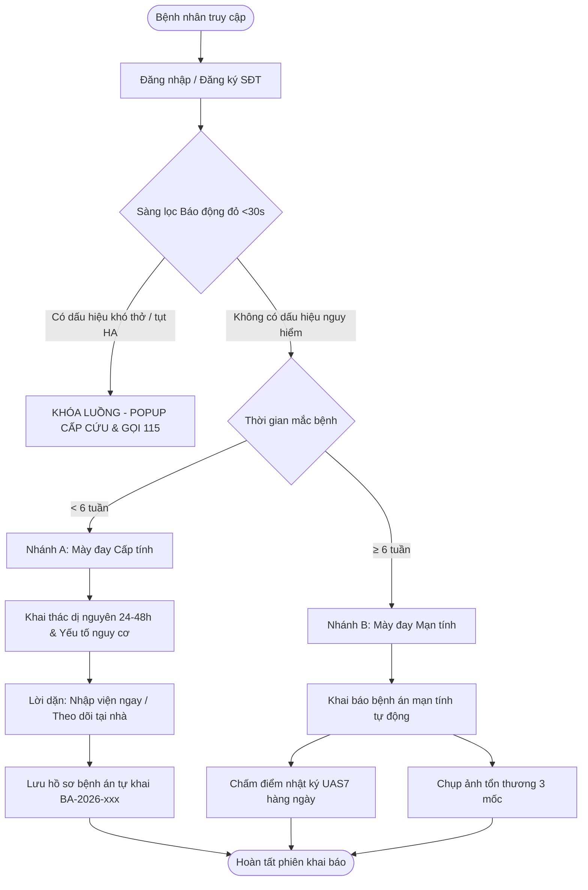
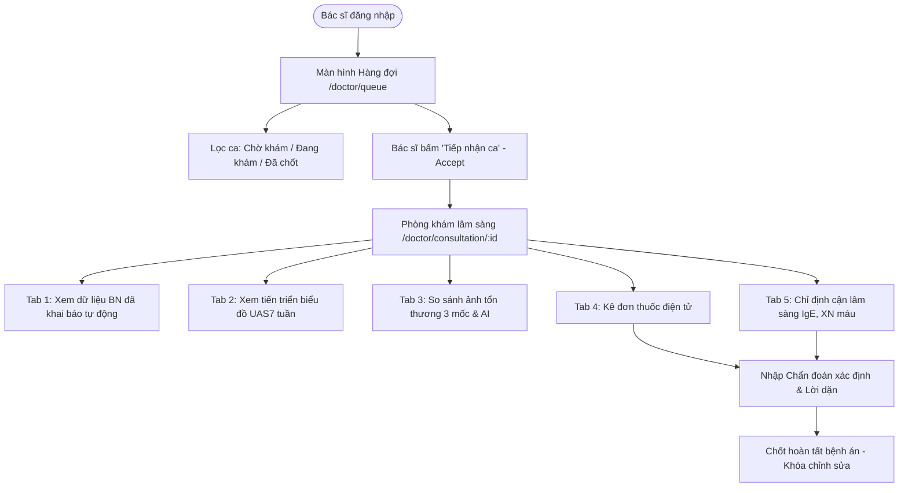

# BẢN ĐỒ CÁC LUỒNG ĐẦU - CUỐI THEO VAI TRÒ (11-FLOW-MAP)

> **Dự án:** Hệ thống Quản trị & Quản lý Bệnh án Lâm sàng Mày đay — DrMayDay  
> **Đơn vị:** Bệnh viện Da liễu Trung ương  
> **Quy chuẩn:** End-to-End Workflow & Exception Path Specification  

---

## 1. PHÂN HỆ BỆNH NHÂN (PATIENT WORKFLOWS)

### Chi Tiết Từng Luồng Bệnh Nhân:
1. **Luồng P1: Đăng nhập & Đăng ký số điện thoại**
   - *Điểm bắt đầu:* Truy cập trang chủ hoặc màn hình `/login`.
   - *Các bước:* Nhập SĐT định danh (kiểm tra Regex `03|05|07|08|09` + 8 số) & Mật khẩu &rarr; Bấm "Đăng Nhập" &rarr; Gửi request `POST /api/auth/login`.
   - *Kết thúc thành công:* Nhận JWT Bearer Token, lưu phiên, điều hướng sang `/patient/home`.
   - *Nhánh ngoại lệ:* Sai thông tin (báo lỗi chung tiếng Việt); Mất kết nối (báo thử lại); Chưa có tài khoản (chuyển sang `/register`).

2. **Luồng P2: Sàng lọc "Báo động đỏ" (<30 giây) & Khóa luồng khẩn cấp**
   - *Điểm bắt đầu:* Màn hình `/patient/emergency`.
   - *Các bước:* Trả lời 4 câu hỏi nhanh: Khó thở/thở rít; Sưng phù mí mắt/môi/họng kèm nuốt vướng; Chóng mặt/vã mồ hôi/tụt huyết áp; Nôn mửa/đau quặn bụng dữ dội sau tiếp xúc dị nguyên.
   - *Nhánh khẩn cấp:* Nếu **CÓ** bất kỳ dấu hiệu nào &rarr; **Khóa luồng toàn bộ** &rarr; Hiện màn hình đỏ cảnh báo sốc phản vệ &rarr; Cung cấp nút gọi cấp cứu `115` và hotline `1900 6951` &rarr; Kết thúc luồng tại đây.
   - *Nhánh an toàn:* Nếu **KHÔNG** &rarr; Tự động kích hoạt chuyển sang Luồng P3.

3. **Luồng P3: Phân nhánh Cấp tính vs Mạn tính (Ngưỡng 6 tuần)**
   - *Điểm bắt đầu:* Bước 2 của quy trình tiếp nhận.
   - *Các bước:* Hỏi: *"Các nốt mày đay của bạn xuất hiện ngắt quãng hay liên tục trong thời gian bao lâu?"*.
   - *Nhánh A (Cấp tính - `< 6 tuần`):* Chuyển hướng sang bộ câu hỏi sàng lọc dị nguyên (thức ăn lạ, thuốc kháng sinh/NSAIDs, vắc xin, côn trùng đốt) trong 24-48 giờ trước. Cảnh báo nguy cơ và sinh bệnh án cấp.
   - *Nhánh B (Mạn tính - `≥ 6 tuần`):* Kích hoạt bộ phiếu khám mày đay mạn tính, mở quyền theo dõi nhật ký UAS7 và ảnh 3 mốc.

4. **Luồng P4: Khai báo bệnh án động (Dynamic Intake)**
   - *Điểm bắt đầu:* Màn hình `/patient/intake`.
   - *Các bước:* Tải danh sách phân mục và câu hỏi động theo template &rarr; Trả lời từng câu hỏi &rarr; Ứng dụng tự động ẩn/hiện câu hỏi con theo logic `show_if_answer` &rarr; Bấm "Gửi Phiếu Khám".
   - *Dữ liệu gửi:* `POST /api/medicalrecords/selfcreate` với payload `{ template_id, answers: [...] }`.
   - *Kết thúc:* Nhận mã hồ sơ bệnh án `BA-2026-xxx`, đưa vào hàng đợi bác sĩ.

5. **Luồng P5: Nhật ký theo dõi UAS7 hàng ngày**
   - *Điểm bắt đầu:* Màn hình `/patient/uas7`.
   - *Các bước:* Gọi `GET /api/uas7scores/eligibility` kiểm tra điều kiện &rarr; Chọn mức độ sẩn phù (0-3) & mức độ ngứa ngáy (0-3) &rarr; Hệ thống tính điểm ngày (0-6) &rarr; Bấm "Lưu Nhật Ký Ngày".
   - *Dữ liệu gửi:* `POST /api/uas7scores` với `{ medical_record_id, score_date, iss7, hss7 }`.
   - *Nhánh ngoại lệ:* Nếu ngày hôm nay đã chấm rồi &rarr; Backend trả mã lỗi `5002` &rarr; Giao diện thông báo: *"Hôm nay bạn đã ghi nhận điểm rồi, hãy quay lại vào ngày mai!"*.
   - *Hiển thị tổng kết:* Tự động cập nhật biểu đồ 7 ngày gần nhất và tổng điểm tuần (0-42) xếp hạng mức độ hoạt động bệnh.

6. **Luồng P6: Chụp & Tải ảnh tổn thương 3 giai đoạn lâm sàng**
   - *Điểm bắt đầu:* Màn hình `/patient/lesions`.
   - *Các bước:* Chọn hoặc tạo đợt bùng phát (Episode) &rarr; Chọn mốc tổn thương cần tải:
     - Mốc 1: Khởi phát ban đầu (`milestone: start`)
     - Mốc 2: Bùng phát đỉnh điểm (`milestone: peak`)
     - Mốc 3: Sau dùng thuốc / Thuyên giảm (`milestone: normal`)
   - *Dữ liệu gửi:* Upload ảnh qua `POST /api/media/upload` (multipart) &rarr; Gắn ảnh vào vị trí tổn thương qua `POST /api/lesion_photos`.

---

## 2. PHÂN HỆ BÁC SĨ (DOCTOR WORKFLOWS)

### Chi Tiết Từng Luồng Bác Sĩ:
1. **Luồng D1 & D2: Hàng đợi ca khám & Tiếp nhận bệnh nhân**
   - *Điểm bắt đầu:* Màn hình `/doctor/queue`.
   - *Các bước:* Hệ thống tải danh sách ca khám từ `GET /api/medicalrecords/queue`. Bác sĩ có thể tìm theo SĐT, tên bệnh nhân, hoặc lọc theo thẻ trạng thái.
   - *Thao tác:* Bác sĩ bấm nút **"Tiếp nhận ca khám"** &rarr; Gọi `POST /api/medicalrecords/{id}/accept` &rarr; Ca bệnh chuyển trạng thái `in_progress` và chuyển ngay vào phòng khám chi tiết `/doctor/consultation/:id`.

2. **Luồng D3: Khám lâm sàng & Đối chiếu dữ liệu đa tầng**
   - *Giao diện 5 Tab chuyên sâu:*
     - **Tab 1 (Phiếu khám):** Hiển thị toàn bộ câu trả lời bệnh nhân đã khai từ trước (dấu hiệu ban đầu, thời gian tồn tại từng sẩn, triệu chứng phù mạch, yếu tố nghi ngờ).
     - **Tab 2 (Biểu đồ UAS7):** Biểu đồ đường phân tích song song điểm sẩn phù vs điểm ngứa ngáy trong 7 ngày, tổng điểm tuần và mức độ bệnh.
     - **Tab 3 (Ảnh tổn thương):** Đối chiếu trực quan hình ảnh 3 giai đoạn (Khởi phát &rarr; Đỉnh điểm &rarr; Sau điều trị) kèm kích thước nhận diện AI.

3. **Luồng D4: Kê đơn thuốc điện tử**
   - *Điểm bắt đầu:* Tab 4 tại phòng khám.
   - *Các bước:* Bấm "Thêm Thuốc Vào Đơn" &rarr; Nhập tên thuốc/biệt dược, hàm lượng (ví dụ: `180mg`), tần suất (`1 lần/ngày`), liệu trình (`14 ngày`), hướng dẫn sử dụng &rarr; Bấm "Lưu Thuốc".
   - *Dữ liệu gửi:* `POST /api/prescriptions` với body `{ medical_record_id, note, items: [...] }`.

4. **Luồng D5: Chỉ định cận lâm sàng**
   - *Điểm bắt đầu:* Tab 5 tại phòng khám.
   - *Các bước:* Bác sĩ chỉ định các xét nghiệm cần thiết: Công thức máu (WBC, Eosinophil), Định lượng IgE toàn phần, Panel 64 dị nguyên, Chức năng tuyến giáp TSH.
   - *Dữ liệu gửi:* `POST /api/lab_requests` với body `{ medical_record_id, items: [...] }`.

5. **Luồng D6: Kết luận chẩn đoán & Chốt hoàn tất hồ sơ**
   - *Điểm bắt đầu:* Khung kết luận chân trang phòng khám.
   - *Các bước:* Bác sĩ nhập **Chẩn đoán xác định** (bắt buộc) + **Lời dặn điều trị & Hẹn tái khám** &rarr; Bấm nút **"Chốt Hoàn Tất Bệnh Án"**.
   - *Dữ liệu gửi:* `POST /api/medicalrecords/{id}/complete` với `{ status: 'completed', instructions: '...' }`.
   - *Kết thúc:* Hồ sơ chuyển trạng thái `completed`, khóa toàn bộ quyền chỉnh sửa để bảo toàn tính pháp lý của bệnh án.

---

## 3. PHÂN HỆ QUẢN TRỊ VIÊN (ADMIN WORKFLOWS)

1. **Luồng A1: Quản trị Cây hạ tầng cơ sở 3 tầng (`/admin/topology`)**
   - Quản lý phân cấp: **Chi nhánh cơ sở** &rarr; **Khoa chuyên môn** &rarr; **Phòng khám trực tiếp**.
   - Thêm/sửa/xóa từng tầng qua `GET, POST, DELETE /api/branches, /api/departments, /api/rooms`.
   - Ràng buộc an toàn: Bắt mã lỗi `3001` chặn xóa nếu tầng dưới còn dữ liệu phụ thuộc.

2. **Luồng A2: Quản trị nhân sự & Phân công công tác (`/admin/users`)**
   - Danh sách toàn bộ tài khoản trong hệ thống.
   - Tạo tài khoản nhân sự y tế (`POST /api/staff`).
   - Điều chuyển và gán phòng làm việc trực tiếp (`POST /api/staff/:id/assign`).

3. **Luồng A3: Quản trị Ma trận vai trò & Phân quyền RBAC (`/admin/rbac`)**
   - Tạo vai trò phân cấp kế thừa (`POST /api/roles`).
   - Chọn vai trò & gán danh mục quyền chi tiết qua `POST /api/roles/{id}/permissions`.

4. **Luồng A4: Trình thiết kế biểu mẫu khám y tế động (`/admin/form-builder`)**
   - Thiết kế 4 tầng: Tạo Template phiếu khám &rarr; Thêm Phân mục &rarr; Thêm Câu hỏi &rarr; Thêm Danh sách lựa chọn trả lời.
   - Cấu hình điều kiện rẽ nhánh `show_if_answer` phụ thuộc câu hỏi cha.

---

## 4. CÁC LUỒNG ĐỀ XUẤT CHỜ XÁC NHẬN (PROPOSALS PENDING APPROVAL)

| Mã Luồng | Tên luồng đề xuất | Mục đích nghiệp vụ | Hiện trạng trong API / Tài liệu | Kiến nghị giải pháp |
|:---:|:---|:---|:---|:---|
| **P-FLOW-01** | Quên mật khẩu & Đặt lại qua mã OTP | Cho phép bệnh nhân và nhân viên tự khôi phục mật khẩu khi quên. | API spec có `forgot_password` và `reset_password` nhưng chưa có giao diện trên Frontend. | Xây dựng 2 màn hình `/forgot-password` và `/reset-password` tuân thủ đúng Uber Base tokens. |
| **P-FLOW-02** | In / Xuất đơn thuốc & Tóm tắt bệnh án PDF | Cho phép bác sĩ hoặc bệnh nhân tải/in bản tóm tắt điều trị và đơn thuốc dạng giấy A4. | Slide và tài liệu nghiệp vụ có nhắc đến xuất file nhưng chưa có endpoint xuất PDF. | Tạm thời tạo chức năng in chuẩn CSS `@media print` tối ưu theo khổ giấy bệnh viện Da liễu TW. |
| **P-FLOW-03** | Khảo sát kiểm soát bệnh UCT / AECT / DLQI | Đánh giá điểm chất lượng cuộc sống của bệnh nhân mày đay mạn tính. | Tài liệu `Thiet_ke_giao_dien_Bac_si_BA_man_chot.docx` ghi rõ: *"Hiện chỉ có ô nhập điểm tổng do bác sĩ điền, KHÔNG có bộ câu hỏi chi tiết"*. | Giữ nguyên ô nhập điểm tổng của Bác sĩ; chưa triển khai bộ trắc nghiệm câu hỏi lẻ cho đến khi Hội đồng Bệnh viện ban hành bảng câu hỏi chính thức. |
